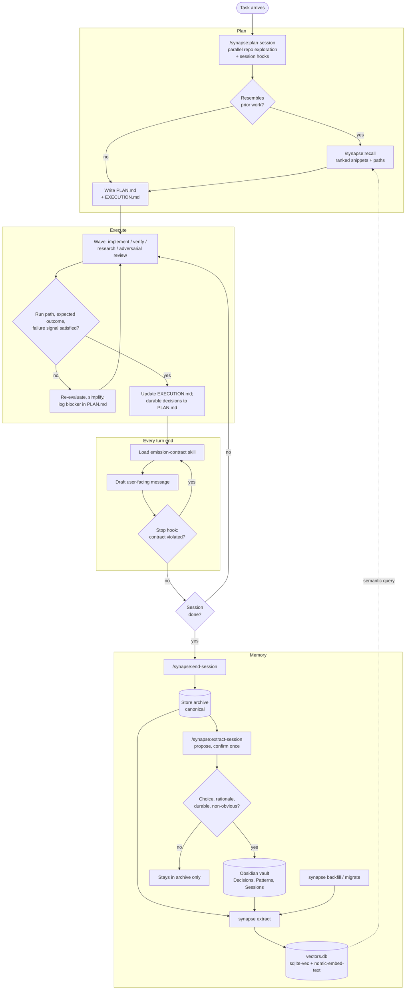

# Architecture

Synapse is a Claude Code plugin that gives every session, in any project, the
same operating loop: plan, execute, archive, and extract, with prior knowledge
recalled at the start of the next session.

Instructions decide *when*; skills decide *how*; Python does the mechanics;
hooks enforce what instructions can only request.

---

## Session lifecycle

1. **Plan** (`/synapse:plan-session`). Explore the repos with batched reads and a
   sub-agent for cross-repo searches; run any session hooks the plan lists;
   `/synapse:recall` when the work resembles prior work. Write
   `.claude-work/current/PLAN.md` (strategy, constraints, Decision Log) and
   `EXECUTION.md` (the active task).
2. **Execute.** Small, verifiable, localized steps, in waves of role-specific
   agents (implementation, verification, research, adversarial review).
   Frontier models plan; right-sized models execute. `EXECUTION.md` updates
   often; `PLAN.md` only for durable decisions.
3. **Emit** (every turn end). The `synapse:emission-contract` skill loads just before
   the user-facing message. A Stop hook checks the message and forces one
   rewrite on a violation.
4. **Archive** (`/synapse:end-session`). `synapse archive` copies `PLAN` and
   `EXECUTION` into the active store as `archive/<project>/<FILE>_<id>.md`
   under a session ID such as `2026-05-01-1515`; the skill adds `NOTES`.
5. **Extract** (`/synapse:extract-session`). At teardown, while context is fresh,
   Claude proposes Decision and Pattern notes and the user confirms once.
   Promoted notes and a Session note go to the vault; the archive and new
   notes are embedded; a `.processed/<id>.json` marker records the run.
6. **Recall** (`/synapse:recall`). Later sessions, in any project, query the
   active store's vector DB and get ranked
   snippets with source paths: pointers into the archive, not loaded context.

`/synapse:workflow-recovery` sits outside the loop: when a background workflow dies,
it harvests finished agents' results from disk before anything is relaunched.

---

## Components

| Layer | Component | Role |
|-------|-----------|------|
| Package | `.claude-plugin/` | Plugin manifest plus a marketplace manifest, so the repo installs with one command at user scope |
| Instructions | `instructions/core.md` | Always-on rules (lifecycle, planning, validation, waves and model right-sizing, recall and emission triggers), injected by a `SessionStart` hook; under 10,000 characters |
| Instructions | `instructions/platform-*.md` | Shell conventions for macOS or Windows, picked by the same hook from `uname` |
| Skills | `/synapse:plan-session`, `/synapse:end-session` | Session start/resume and archiving |
| Skills | `/synapse:recall`, `/synapse:extract-session` | Memory read and write; extraction holds the promotion gate |
| Skills | `synapse:emission-contract` | Late-bound output contract: a compact directive plus exemplars |
| Skills | `/synapse:workflow-recovery` | Salvage results from an interrupted multi-agent run |
| Skills | `/synapse:language-sweep` | Prose cleanup in strict ASD-STE100 or lite marketing-copy mode |
| Skills | `/synapse:setup`, `/synapse:doctor` | Provision the Synapse home; read-only health and conflict report |
| Agents | `synapse:implementer`, `verifier`, `researcher`, `reviewer`, `scout` | Wave roles with their own models and tool limits; each body carries the rules its job needs, because sub-agents do not receive the `SessionStart` rules |
| Hooks | `emission_check.py` (Stop) | Blocks a non-compliant final message once and asks for a rewrite; allows the stop on `stop_hook_active` or any internal error |
| Hooks | `synapse recall-hint` (UserPromptSubmit), `synapse pending --hook` (SessionStart) | Automatic recall hints and the extraction reminder; both fail silently |
| CLI | `bin/synapse` → `lib/synapse/` | On the Bash PATH from any folder: `where`, `setup`, `doctor`, `archive`, `recall`, `recall-check`, `extract` (incl. `upgrade`, `supersede`), `vault`, `backfill`, `migrate`; `lib/py.sh` finds Python 3.11+ |
| Resolver | `lib/synapse/paths.py` | The only code that decides locations: home, store, project, archive, DB, vault |
| Store | `~/.claude/synapse/stores/<store>/archive/<project>/` | Canonical session history |
| Store | `~/.claude/synapse/stores/<store>/vectors.db` | Schema v2: sqlite-vec vectors with project/type/status metadata filtered inside the search, an FTS5 keyword index, `nomic-embed-text` via Ollama, cosine distance, store-relative source paths, supersession status |
| Store | The store's Obsidian vault (default `Synapse`) | Flat folders: Sessions, Decisions, Patterns, Projects |
| Runtime | Claude Code, auto mode | Controls live in the harness instead of permission prompts |

**Stores.** One global store (`main`) by default. A project can opt into
another with a `.synapse.toml` at its root (`store = "<name>"`), and
`SYNAPSE_STORE` overrides both for a session. A store keeps its archive, vector
DB, and vault together, so splitting a project splits all three.

---

## Operating principles

**Memory**

- Archives are canonical; the vault and the vector DB are regenerable projections.
- Deterministic mechanics in Python, judgment in skills. Scripts never decide what matters.
- Conservative promotion. A Decision must be a choice, carry rationale, stay
  durable, and be non-obvious. A Pattern must transfer across projects and condense.
- Idempotency everywhere: content-hash chunk dedup, `.processed` markers,
  always-replace for edited notes.
- Fail loud: encoding errors, embedding-model mismatches, and unreachable
  services error out rather than write bad data.
- Local only: no egress beyond Claude Code itself, except the one-time
  `sqlite-vec` download from PyPI during setup.
- Recall results are navigation, not context.

**Execution**

- Plan first; explore and reuse existing patterns before introducing new ones.
- Smallest localized change; no unrelated refactors or scope growth.
- Every change carries a run path, an expected outcome, and a failure signal.
- Token discipline: no re-reading unchanged files; conclusions cached in `PLAN.md`.
- When blocked: re-evaluate assumptions, search alternatives, simplify, log the blocker.

**Orchestration**

- Batch parallel tool calls during exploration.
- Sub-agents for bounded investigations; waves of role-specific agents for
  implementation, verification, research, and adversarial review.
- Right-size the model to the wave: frontier for planning, cheaper for execution.
- Move controls into the harness, then remove permission prompts (auto mode).

**Output**

- Keep style constraints out of the reasoning context.
- Bind the output contract late, through a skill loaded just before emission.
- Enforce deterministically with a Stop hook rather than trusting the model to self-trigger.

---

## Operating loop

The execution loop repeats per wave inside a session; the memory loop closes
across sessions when `vectors.db` feeds the next `/recall`.

The Session note is written to the vault on every extraction and is left out
of the gate above for readability. The emission check fires at every turn end,
not only at session close.

---

## Toward V2

V1 enforces the output contract with a hook but leaves recall, extraction, and
role selection to instructions. Each row is a place where probabilistic
triggering could become deterministic, at some cost.

| Seam | 2.0 today | V2 option | Trade-off |
|------|------------|-----------|-----------|
| Recall triggering | **Done in V2 slice D:** a `UserPromptSubmit` hook adds up to three hints scoring ≥ 0.70, once per session, failing silently | Per-project thresholds | Calibrated on the author's store: 0 of 24 unrelated prompts hinted |
| Extraction | **Done in V2 slice D:** a session-start reminder lists archived sessions never extracted; the user still runs `/synapse:extract-session` | Auto-embed pending archives without promotion | Nothing is forgotten silently; judgment stays with a live session |
| Role orchestration | **Done in V2 slice C:** five plugin agents with per-role models, tool limits, and their own rules; measured with an eval suite | Hooks that route work to a role | Right-sizing is config; agent files to maintain |
| Memory hygiene | **Done in V2 slice 1:** `synapse extract supersede` marks the old decision in the DB and its front matter; recall hides it by default | Detect likely supersessions during extraction | Fewer near-duplicate decisions left active |
| Retrieval | **Done in V2 slice 1:** hybrid keyword + vector with reciprocal rank fusion; exact, case-insensitive filters inside the search | Tuned chunking; a cross-encoder re-ranker | Measured with `synapse recall-check` |
| Memory scope | Local, single user | Shared team store | Team leverage; poisoned entries propagate and secrets can leak across people. **Gate:** extraction must first scrub session-local references (bare `#17`, "Wave B", "yesterday's session") and user paths or machine ids, generalizing them to context another reader can use |
| Evaluation | Judged by feel and throughput; agent evals deferred (2026-10-26), to revisit before deterministic triggers ([V2 plan](design/v2.md)) | Harness Bench runs baseline, v1.6, and v2 on fixed tasks, built on `claude plugin eval` | Changes become measurable; benchmark upkeep is real work |

Closed since V1: v1.5 merged the instruction files and split out the platform
conventions; v1.6 packaged Synapse as a user-scope plugin with a global store
([design](design/packaging.md)). An MCP server for memory, the natural
transport for a shared store, belongs with the memory-scope row.
