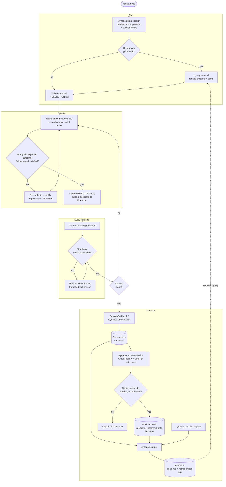

# Architecture

Synapse is a Claude Code plugin that gives every session, in any project, the
same operating loop: plan, execute, archive, and extract, with prior knowledge
recalled in later sessions, on demand and automatically, and optionally
shared with a small team.

Instructions decide *when*; skills decide *how*; Python does the mechanics;
hooks enforce what instructions can only request.

---

## Session lifecycle

1. **Plan** (`/synapse:plan-session`). Explore the repos with batched reads and a
   sub-agent for cross-repo searches; run any session hooks the plan lists;
   `/synapse:recall` when the work resembles prior work. Write
   `.claude-work/current/PLAN.md` (strategy, constraints, Decision Log) and
   `EXECUTION.md` (the active task).
2. **Execute.** Small, verifiable, localized steps, in waves of role-specific
   agents (implementation, verification, research, adversarial review).
   Frontier models plan; right-sized models execute. `EXECUTION.md` updates
   often; `PLAN.md` only for durable decisions.
3. **Emit** (every turn end). A Stop hook checks the user-facing message and,
   on a violation, forces one rewrite; its block reason carries the contract's
   directive, so no skill load is needed. `synapse:emission-contract` is the
   reference text (2.6.1: the per-turn load rule held only while fresh).
4. **Checkpoint** (`/synapse:checkpoint`, any time). Writes `## Resume` in
   `EXECUTION.md` and appends to the working `NOTES.md` (stated facts,
   patterns, decision rationale, open questions, deferred and blocked work)
   without ending the turn; idempotent. After it, `/clear` loses nothing
   and `/compact` is lossy. `synapse checkpoint --stamp` records the time.
   After `/clear` or a compaction, SessionStart adds a one-line pointer to
   the Resume section.
5. **Archive** (SessionEnd hook, or `/synapse:end-session`). At exit, `/clear`
   and a `/resume` switch, `synapse archive --auto --hook` copies `PLAN`,
   `EXECUTION`, `REPORT` and `NOTES` into the active store as
   `archive/<project>/<FILE>_<id>.md` with no model call, in about 60 ms
   (`[archive] on_exit = false` turns it off). `/synapse:end-session` archives
   on request under a session ID such as `2026-05-01-1515`, writes `NOTES`
   from the working `NOTES.md` that checkpoints filled, and runs extraction
   last.
6. **Extract** (`/synapse:extract-session`). The
   `synapse:extractor` sub-agent reads the archive on disk, without the
   conversation, and drafts Decision, Pattern, and Fact notes. With
   `[extract] accept = auto` (the default) the skill writes them without
   asking and `synapse extract review` lists them later; `accept = review`
   asks once first. `[extract] on_exit` (off by default) runs the same
   extraction detached after the SessionEnd archive. Facts the user stated reach it through NOTES
   `## User-stated facts`.
   Promoted notes and a Session note go to the vault; the archive and new
   notes are embedded; a `.processed/<id>.json` marker records the run.
7. **Recall** (`/synapse:recall`). Later sessions, in any project, query the
   active store's vector DB and get ranked snippets with source paths:
   pointers into the archive, not loaded context. A `UserPromptSubmit` hook
   also adds up to three such pointers to a prompt when something in the
   store scores at least 0.70, and a session-start note names archived
   sessions never extracted. Another session-start hook lists the project's
   active Facts from the DB (`synapse facts --hook`).
8. **Share** (`/synapse:share`, optional). Chosen Decisions, Patterns, and Facts pass
   a scrub gate and the user's approval, then go to a team folder (a git
   repo or a synced folder). Each member's sessions sync it in the
   background and index it locally, so teammates' notes join recall,
   labeled, with the member's own decisions winning a conflict.

`/synapse:workflow-recovery` sits outside the loop: when a background workflow dies,
it harvests finished agents' results from disk before anything is relaunched.

---

## Components

| Layer | Component | Role |
|-------|-----------|------|
| Package | `.claude-plugin/` | Plugin manifest plus a marketplace manifest, so the repo installs with one command at user scope |
| Instructions | `instructions/core.md` | Always-on rules (lifecycle, planning, validation, waves and model right-sizing, recall, team-note, and emission triggers), injected by a `SessionStart` hook; under 10,000 characters |
| Instructions | `instructions/platform-*.md` | Shell conventions for macOS or Windows, picked by the same hook from `uname` |
| Skills | `/synapse:plan-session`, `/synapse:end-session` | Session start/resume and archiving |
| Skills | `/synapse:recall`, `/synapse:extract-session` | Memory read and write; extraction holds the promotion gate |
| Skills | `/synapse:share` | Scrub, show, and share approved notes with a team; ask before each push |
| Skills | `synapse:emission-contract` | Reference text of the output contract the Stop hook enforces: directive, checked patterns, exemplars |
| Skills | `/synapse:workflow-recovery` | Salvage results from an interrupted multi-agent run |
| Skills | `/synapse:language-sweep` | Prose cleanup in strict ASD-STE100 or lite marketing-copy mode |
| Skills | `/synapse:setup`, `/synapse:doctor` | Provision the Synapse home; read-only health and conflict report |
| Agents | `synapse:implementer`, `verifier`, `researcher`, `reviewer`, `scout`, `extractor` | Wave roles with their own models and tool limits (the extractor is dispatched by `/synapse:extract-session`, not by waves); each body carries the rules its job needs, because sub-agents do not receive the `SessionStart` rules |
| Hooks | `emission_check.py` (Stop) | Blocks a non-compliant final message once; the reason names the violations and carries the contract's directive (from `emission_patterns.json`); allows the stop on `stop_hook_active` or any internal error, which it logs to stderr |
| Hooks | `synapse gate --hook` (PreToolUse on Edit, Write, MultiEdit, NotebookEdit, Bash, PowerShell; Stop) | Denies a hands-on call once per crossing at 5, 10 and 20 calls in a step when the context is at least `[gate] min_context` (0.5) of the window, naming the role to brief; the retry goes through and a dispatch or new prompt re-arms it. On Stop, blocks once at 60% and once at 90% of the window to ask for `/synapse:checkpoint` when `## Resume` is stale, and once per prompt while a dispatched sub-agent is still running. A project's `.synapse.toml` may override `[gate]` and `[nudge]` |
| Hooks | `synapse archive --auto --hook` (SessionEnd) | Copies `.claude-work/current/` into the store at exit, `/clear` and a `/resume` switch: no model call, about 60 ms inside Claude Code's shared 1.5 s SessionEnd budget; skips when nothing changed; `[extract] on_exit = true` then starts a detached headless extraction (off by default) |
| Hooks | `synapse recall-hint` (UserPromptSubmit), `synapse pending --hook` and `synapse shared hook` (SessionStart) | Automatic recall hints, the extraction reminder, the count of notes automatic extraction wrote (`synapse extract review`), and the team sync (started in the background); all fail silently |
| Hooks | `synapse compact-guide --hook` (PreCompact) | Tells the compaction summary what to keep and drop; defers to the user's `/compact` text; never blocks; fails silently |
| Hooks | `synapse nudge --hook` (PostToolUse, PostToolUseFailure, UserPromptSubmit, SessionStart) | Dispatch reminder after consecutive hands-on calls (below `[gate] min_context`; above it the PreToolUse gate denies instead); context-size nudge at 60% and 90% of the window (`[nudge] context_window`, else Claude Code's auto-compact point when its settings set a window (the window, capped at the model's, less a 33k buffer; `autocompact.py`), else the model-name rule: 300000 for 1M-window models (Fable, Opus 4.7 and later, any 5-series model), 150000 for older ones, lowered by the smallest auto-compaction `preTokens` seen in the session, kept in `context-<sid>.json`)), read from the transcript's tail; resume-time line when the cache expired on a large context; resume pointer after `compact` or `clear`. One process, no new matcher in 2.6.0; never blocks; no Ollama or DB; silent on any error |
| CLI | `bin/synapse` → `lib/synapse/` | On the Bash PATH from any folder: `where`, `setup` (incl. `--autocompact`), `doctor`, `archive` (incl. `--auto --hook`), `recall`, `recall-check`, `recall-hint`, `pending`, `facts`, `compact-guide`, `nudge`, `gate`, `checkpoint`, `extract` (incl. `upgrade`, `supersede`, `check-candidates`, `review`), `vault`, `share` (`scrub`, `lint`, `add`), `shared` (`init`, `join`, `sync`, `status`, `retract`, `push`), `backfill`, `migrate`; `lib/py.sh` finds Python 3.11+ |
| Resolver | `lib/synapse/paths.py` | The only code that decides locations: home, store, project, archive, DB, vault |
| Store | `~/.claude/synapse/stores/<store>/archive/<project>/` | Canonical session history |
| Store | `~/.claude/synapse/stores/<store>/vectors.db` | Schema v2: sqlite-vec vectors with project/type/status metadata filtered inside the search, an FTS5 keyword index, `nomic-embed-text` via Ollama, cosine distance, store-relative source paths, supersession status |
| Store | The store's Obsidian vault (default `Synapse`) | Flat folders: Sessions, Decisions, Patterns, Facts, Projects |
| Team | A team's notes folder (a clone under `~/.claude/synapse/shared/<team>/`, or a synced folder) | `Decisions/`, `Patterns/`, `Facts/`, `Retracted/`: the scrubbed notes members share |
| Team | `~/.claude/synapse/shared/<team>/vectors.db` | Each member's local index of the team folder, rebuilt by content hash; never shared |
| Evals | `evals/`, `tools/run-bench.sh`, `tools/eval-report.py` | A `claude plugin eval` suite run with and without Synapse; run on demand, never in CI |
| Runtime | Claude Code, auto mode | Controls live in the harness instead of permission prompts |

**Stores.** One global store (`main`) by default. A project can opt into
another with a `.synapse.toml` at its root (`store = "<name>"`), and
`SYNAPSE_STORE` overrides both for a session. A store keeps its archive, vector
DB, and vault together, so splitting a project splits all three. Teams
(`[shared.<team>]` in `config.toml`) are searched alongside the stores they
list, or every store by default.

---

## Operating principles

**Memory**

- Archives are canonical; the vault and the vector DB are regenerable projections.
- Deterministic mechanics in Python, judgment in skills. Scripts never decide what matters.
- Conservative promotion. A Decision must be a choice, carry rationale, stay
  durable, and be non-obvious. A Pattern must transfer across projects and condense.
  A Fact must come from the user, be absent from the code, and change what
  an agent does.
- Idempotency everywhere: content-hash chunk dedup, `.processed` markers,
  always-replace for edited notes.
- Fail loud: encoding errors, embedding-model mismatches, and unreachable
  services error out rather than write bad data.
- Local by default: no egress beyond Claude Code itself, except the
  one-time `sqlite-vec` download from PyPI during setup. With a team, only
  the notes the user approves leave the machine, through the team's git
  remote or sync service, and teammates' notes pass the same scrub gate on
  the way in.
- Recall results are navigation, not context.

**Execution**

- Plan first; explore and reuse existing patterns before introducing new ones.
- Smallest localized change; no unrelated refactors or scope growth.
- Every change carries a run path, an expected outcome, and a failure signal.
- Token discipline: no re-reading unchanged files; conclusions cached in `PLAN.md`.
- When blocked: re-evaluate assumptions, search alternatives, simplify, log the blocker.

**Orchestration**

- Batch parallel tool calls during exploration.
- Sub-agents for bounded investigations; waves of role-specific agents for
  implementation, verification, research, and adversarial review.
- Right-size the model to the wave: frontier for planning, cheaper for execution.
- Move controls into the harness, then remove permission prompts (auto mode).

**Output**

- Keep style constraints out of the reasoning context.
- Keep the output contract out of the context until it is needed: the Stop
  hook's block reason carries it, only when a message breaks it.
- Enforcement over instruction: a rule the model reads decays within a
  session (2.6.1 measured the per-turn skill load at 5 of 91 turns, all
  early); a hook gate holds. The Stop hook carries the emission contract,
  the PreToolUse gate denies the hands-on call the rules only discouraged,
  and the Stop gate asks for the checkpoint the nudge only suggested.
- A per-turn skill load is one extra full-context request per turn, a cost
  anti-pattern; rules the model must see every turn go into the hook's block
  reason or a one-line prompt digest, not a skill.
- Tail-end work (archive, extraction) runs from hooks and the CLI, not from
  the model's memory of a rule: SessionEnd archives, extraction writes by
  default and lists for review.

---

## Operating loop

The execution loop repeats per wave inside a session; the memory loop closes
across sessions when `vectors.db` feeds the next `/recall`.

The Session note is written to the vault on every extraction and is left out
of the gate above for readability. The emission check fires at every turn end,
not only at session close. Not drawn: the automatic hint (the
`UserPromptSubmit` hook queries the same `vectors.db` on each prompt) and
team sharing (approved notes go to a team folder that every member indexes
next to their own store).

---

## V2 status

V1 enforced the output contract with a hook but left recall, extraction, and
role selection to instructions. V2 took each seam below in a measured slice
([plan and results](design/v2.md)); the last column is what could come next.

| Seam | Today (2.7) | Further option | Trade-off |
|------|------------|-----------|-----------|
| Recall triggering | **Done in V2 slice D:** a `UserPromptSubmit` hook adds up to three hints scoring ≥ 0.70, once per session, failing silently | Per-project thresholds | Calibrated on the author's store: 0 of 24 unrelated prompts hinted |
| Extraction | **Done in V2 slice D, 2.7.0:** a session-start reminder lists archived sessions never extracted; a SessionEnd hook archives at exit; `/synapse:end-session` runs extraction last, writing notes by default (`[extract] accept = auto`) for `synapse extract review` | Detached extraction after exit (`[extract] on_exit`, shipped off; macOS verified, Windows not) | Nothing is forgotten silently; notes written without asking are listed for review |
| Role orchestration | **Done in V2 slice C:** six plugin agents with per-role models, tool limits, and their own rules; measured with an eval suite | Hooks that route work to a role | Right-sizing is config; agent files to maintain |
| Memory hygiene | **Done in V2 slice 1:** `synapse extract supersede` marks the old decision in the DB and its front matter; recall hides it by default. **2.5.0:** extraction recalls every candidate by concept and proposes `supersedes` or a duplicate for hits ≥ 0.70 | Find conflicts among notes already active | Fewer near-duplicate decisions left active |
| Retrieval | **Done in V2 slice 1:** hybrid keyword + vector with reciprocal rank fusion; exact, case-insensitive filters inside the search | Tuned chunking; a cross-encoder re-ranker | Measured with `synapse recall-check` |
| Memory scope | **Done in V2 slice E:** optional teams share Decisions and Patterns through a git repo or a synced folder, behind a scrub gate and per-note approval, with provenance and local-first ranking | Encryption, access control beyond the git host's | Team leverage; a leak cannot be unshared from teammates' clones. **Gate:** the share step scrubs paths, secrets, identifiers, and session-local references (bare `#17`, "Wave B", "this session"), and sync re-checks every incoming note |
| Evaluation | **Done in V2 slice A:** a `claude plugin eval` suite (core loop, role agents, triggers, teams) run with and without Synapse by `tools/run-bench.sh`, reported by `tools/eval-report.py` ([V2 plan](design/v2.md)) | Evals in CI; more cases per seam | Each run costs money; benchmark upkeep is real work |
| Cost | **Done in 2.5.0:** the main session conducts and roles work (more than about five tool calls or three files go to a role); extraction runs in a fresh context as `synapse:extractor`; a PreCompact hook guides the compaction summary; `tools/context-cost.py` measures the baseline ([design](design/cost-sweep.md)). **Done in 2.6.0:** continuation assist: `/synapse:checkpoint`, a resume pointer after `/clear` or compaction, a context-size nudge and a resume-time line in the nudge hook ([design](design/continuation-assist.md)). **Done in 2.6.1 and 2.7.x:** the Stop hook carries the emission contract (no per-turn skill load; `tools/emission-stats.py` counts its verdicts); a PreToolUse gate denies hands-on calls at 5, 10 and 20 above half the window; the Stop hook asks for a checkpoint at 60% and 90%; the window is Claude Code's auto-compact point, the setting less 33k (`autocompact.py`) | Per-project windows; a checkpoint eval case | Smaller main context; one more agent file to maintain |

Closed since V1: v1.5 merged the instruction files and split out the platform
conventions; v1.6 packaged Synapse as a user-scope plugin with a global store
([design](design/packaging.md)); V2 slices 1, C, D, E, and A followed
(2.0.0 to 2.3.0). Still open: slice F, reach (an MCP server for recall
outside Claude Code, a Linux platform profile, other agents' manifests).
