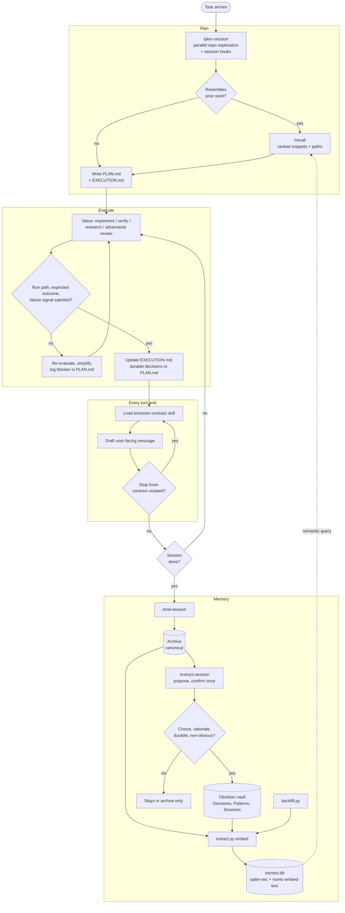

# Architecture

Synapse is an operating layer for Claude Code in a multi-repo workspace. Every
non-trivial session runs plan, execute, archive, and extract, and the next
session starts with prior knowledge recalled.

Instructions decide *when*; skills decide *how*; Python does the mechanics;
hooks enforce what instructions can only request.

---

## Session lifecycle

1. **Plan** (`/plan-session`). Explore the repos with batched reads and a
   sub-agent for cross-repo searches; run any session hooks the plan lists;
   `/recall` when the work resembles prior work. Write
   `.claude-work/current/PLAN.md` (strategy, constraints, Decision Log) and
   `EXECUTION.md` (the active task).
2. **Execute.** Small, verifiable, localized steps, in waves of role-specific
   agents (implementation, verification, research, adversarial review).
   Frontier models plan; right-sized models execute. `EXECUTION.md` updates
   often; `PLAN.md` only for durable decisions.
3. **Emit** (every turn end). The `emission-contract` skill loads just before
   the user-facing message. A Stop hook checks the message and forces one
   rewrite on a violation.
4. **Archive** (`/end-session`). `PLAN`, `EXECUTION`, and `NOTES` are copied
   to `.claude-work/archive/` under a session ID such as `2026-05-01-1515`.
5. **Extract** (`/extract-session`). At teardown, while context is fresh,
   Claude proposes Decision and Pattern notes and the user confirms once.
   Promoted notes and a Session note go to the vault; the archive and new
   notes are embedded; a `.processed/<id>.json` marker records the run.
6. **Recall** (`/recall`). Later sessions query the vector DB and get ranked
   snippets with source paths: pointers into the archive, not loaded context.

`/workflow-recovery` sits outside the loop: when a background workflow dies,
it harvests finished agents' results from disk before anything is relaunched.

---

## Components

| Layer | Component | Role |
|-------|-----------|------|
| Instructions | `AGENTS.md` | The only instruction file, read natively by Claude Code: lifecycle, planning, validation, waves and model right-sizing, recall triggers, emission trigger |
| Instructions | `.claude/rules/platform.md` | Shell and path conventions, installed from `platform/macos.md` or `platform/windows.md` |
| Skills | `/plan-session`, `/end-session` | Session start/resume and archiving |
| Skills | `/recall`, `/extract-session` | Memory read and write; extraction holds the promotion gate |
| Skills | `emission-contract` | Late-bound output contract: a compact directive plus exemplars |
| Skills | `/workflow-recovery` | Salvage results from an interrupted multi-agent run |
| Skills | `language-sweep` | Prose cleanup in strict ASD-STE100 or lite marketing-copy mode |
| Hooks | `emission_check.py` (Stop) | Blocks a non-compliant final message once and asks for a rewrite; allows the stop on `stop_hook_active` or any internal error |
| Scripts | `extract.py`, `recall.py`, `vault_write.py`, `backfill.py` | Chunk, embed, search, write notes, bulk ingest |
| Store | `.claude-work/archive/` | Canonical session history |
| Store | `.claude-work/kb/vectors.db` | sqlite-vec, `nomic-embed-text` via Ollama, cosine distance, model stamped per chunk |
| Store | Obsidian vault (`SYNAPSE_VAULT`, default `Synapse`) | Flat folders: Sessions, Decisions, Patterns, Projects |
| Runtime | Claude Code, auto mode | Controls live in the harness instead of permission prompts |

---

## Operating principles

**Memory**

- Archives are canonical; the vault and the vector DB are regenerable projections.
- Deterministic mechanics in Python, judgment in skills. Scripts never decide what matters.
- Conservative promotion. A Decision must be a choice, carry rationale, stay
  durable, and be non-obvious. A Pattern must transfer across projects and condense.
- Idempotency everywhere: content-hash chunk dedup, `.processed` markers,
  always-replace for edited notes.
- Fail loud: encoding errors, embedding-model mismatches, and unreachable
  services error out rather than write bad data.
- Local only: no egress beyond Claude Code itself.
- Recall results are navigation, not context.

**Execution**

- Plan first; explore and reuse existing patterns before introducing new ones.
- Smallest localized change; no unrelated refactors or scope growth.
- Every change carries a run path, an expected outcome, and a failure signal.
- Token discipline: no re-reading unchanged files; conclusions cached in `PLAN.md`.
- When blocked: re-evaluate assumptions, search alternatives, simplify, log the blocker.

**Orchestration**

- Batch parallel tool calls during exploration.
- Sub-agents for bounded investigations; waves of role-specific agents for
  implementation, verification, research, and adversarial review.
- Right-size the model to the wave: frontier for planning, cheaper for execution.
- Move controls into the harness, then remove permission prompts (auto mode).

**Output**

- Keep style constraints out of the reasoning context.
- Bind the output contract late, through a skill loaded just before emission.
- Enforce deterministically with a Stop hook rather than trusting the model to self-trigger.

---

## Operating loop

The execution loop repeats per wave inside a session; the memory loop closes
across sessions when `vectors.db` feeds the next `/recall`.

The Session note is written to the vault on every extraction and is left out
of the gate above for readability. The emission check fires at every turn end,
not only at session close.

---

## Toward V2

V1 enforces the output contract with a hook but leaves recall, extraction, and
role selection to instructions. Each row is a place where probabilistic
triggering could become deterministic, at some cost.

| Seam | v1.5 today | V2 option | Trade-off |
|------|------------|-----------|-----------|
| Recall triggering | `AGENTS.md` asks Claude to recall when work resembles prior work | A prompt-submit hook runs `recall.py` and injects top-k pointers | Never misses; adds tokens every turn and risks noise on unrelated prompts |
| Extraction | The user runs `/extract-session` at teardown | `/end-session` chains it, or a session-end hook queues it | No forgotten sessions; teardown judgment needs live context, so a detached hook loses quality |
| Role orchestration | Waves and model tiers described in `AGENTS.md` | Roles as agent definition files with model frontmatter | Right-sizing becomes config, not persuasion; more files to maintain |
| Memory hygiene | `supersedes` links exist, but the superseded note stays `active` | Extraction flips the old note's status | Recall stops surfacing stale decisions; extraction gets heavier |
| Retrieval | Pure vector search, ~500-word heading chunks | Hybrid keyword plus vector, filtered by project and type | Better exact-name lookups; one more index to keep in sync |
| Memory scope | Local, single user | Shared team store | Team leverage; poisoned entries propagate and secrets can leak across people |
| Evaluation | Judged by feel and throughput | Harness Bench runs baseline, v1.5, and v2 on fixed tasks | Changes become measurable; benchmark upkeep is real work |

The "single native `AGENTS.md`" seam closed in v1.5, and the platform split
(an OS-neutral core with shell profiles) shipped as well.
